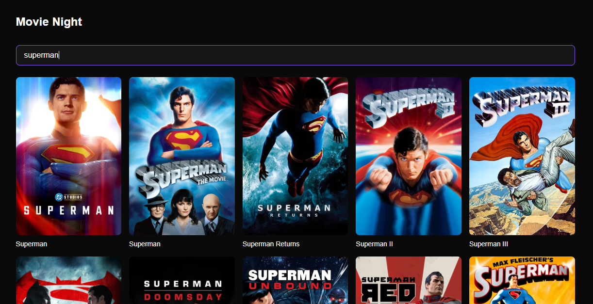

# Movie Night

A movie search app powered by the TMDB API. Type to search, browse results with posters and pagination, and handle loading, empty, and error states gracefully.

**[🔗 Live Demo](https://movie-night-cyan-six.vercel.app)**

## Features

- 🔍 **Debounced search** — waits ~400ms after the last keystroke before firing a request
- 📄 **Pagination** — browse through up to 500 pages of results per query
- 🖼️ **Poster grid** — real movie posters loaded from TMDB's image CDN
- ⚡ **Loading state** — feedback while a search is in flight
- 🚫 **Empty state** — clear message when a search returns no results
- ⚠️ **Error state with retry** — recovers from failed requests without a page reload
- 🌙 **Dark UI** — built with Tailwind CSS

## Tech Stack

- **Next.js** (App Router)
- **React** with hooks (`useState`, `useEffect`)
- **TypeScript** with strict typing
- **Tailwind CSS** for styling
- **TMDB API** for movie data
- **Vercel** for deployment

## Getting Started

\`\`\`bash
git clone https://github.com/Doziedc/movie-night.git
cd movie-night
npm install
\`\`\`

Create a `.env.local` file in the root:

\`\`\`
NEXT_PUBLIC_TMDB_API_KEY=your_tmdb_api_key_here
\`\`\`

Get a free key at [themoviedb.org](https://www.themoviedb.org/settings/api).

Then run:

\`\`\`bash
npm run dev
\`\`\`

Open [http://localhost:3000](http://localhost:3000).

## What I Learned

I built this to practice fetching data from an external API in React and Next.js. My habit tracker before this used only local state. This project added real network requests, timing issues, and failure modes.

Some things I worked through:

- **Debouncing with cleanup** — without debouncing, every keystroke fires a fetch. I wrapped the fetch in a `setTimeout` and returned a `clearTimeout` cleanup from the effect. When the user types again, React calls the previous cleanup first, cancelling the pending timer. Only the last timer survives. This is the subscribe/unsubscribe pattern — every `useEffect` that sets up something (timer, subscription, socket) should return a cleanup that tears it down.

- **Race conditions** — even with debouncing, a slow response can arrive *after* a newer one and overwrite fresh results with stale data. `clearTimeout` only cancels pending timers, not fetches already in flight. Fixed with a `cancelled` flag captured in the effect's closure: the cleanup sets it to `true`, and both `.then()` and `.catch()` bail out if it's set. (The stricter fix is `AbortController`, which actually cancels the request at the network layer — I chose the flag for simplicity.)

- **Environment variables** — my TMDB key lives in `.env.local`, which is git-ignored so it never reaches GitHub. The `NEXT_PUBLIC_` prefix tells Next.js to expose the value to the browser. For TMDB that's fine (their keys are designed for client-side use), but for a paid API I'd keep the key server-side and proxy requests through a Next.js route handler.

- **API error shapes** — TMDB doesn't always return `results`. When the key is invalid or the request is malformed, it returns `{ success: false, status_message: "..." }` instead. My first version assumed `results` was always there and crashed with "Cannot read properties of undefined". Fixed by checking `if (!json.results)` in the fetch callback and routing the bad response to the error state.

- **Type narrowing** — TypeScript doesn't know `data.results` is safe to access unless you guard it first. Using `data?.results && data.results.length > 0` before rendering narrows the type from `SearchResponse | null` to something safe.

## Attribution

This product uses the TMDB API but is not endorsed or certified by TMDB.

## Author

**Akujobi Daniel**
- GitHub: [@Doziedc](https://github.com/Doziedc)
- Live: [movie-night-cyan-six.vercel.app](https://movie-night-cyan-six.vercel.app)